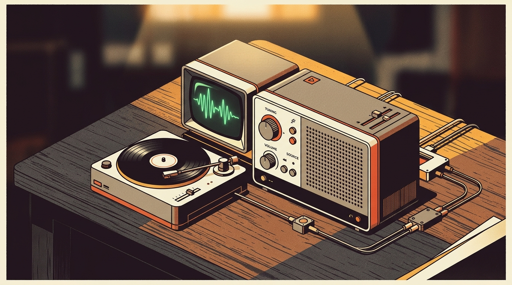
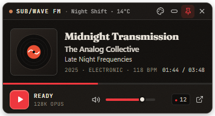
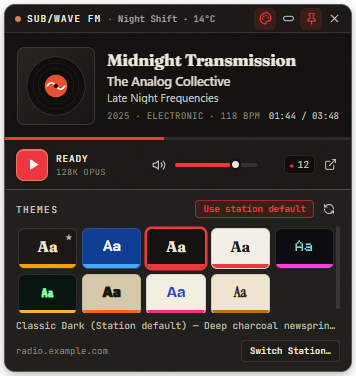
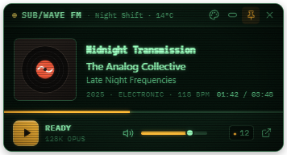
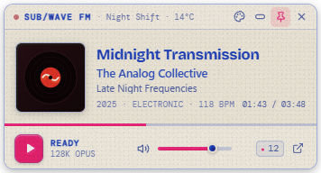
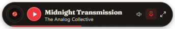

# SubWave Desktop Widget



[](https://github.com/wyliebutler/Subwave_widget/releases)
[-0a3a92)](#installation)
[-161412)](#macos-apple-silicon--m1m2m3m4)
[](./LICENSE)

A compact, frameless **desktop radio widget** for **Windows** and **macOS (Apple Silicon)** built for any self-hosted **[SUB/WAVE](https://github.com/perminder-klair/subwave)** station.

SUB/WAVE's full-screen web player is expressive and rich, but keeping an entire browser window open all day takes up valuable desk space. **SubWave Widget** distills the broadcast down to a tiny, tactile desktop companion — preserving **100% of your station's live themes, typography, textures, and metadata** in a footprint smaller than a sticky note.

---

## Table of Contents

- [Visual Tour](#visual-tour)
- [Key Features](#key-features)
- [Installation](#installation)
- [Connecting to a Station](#connecting-to-a-station)
- [Controls & Shortcuts](#controls--shortcuts)
- [Theme Engine & Custom Station Palettes](#theme-engine--custom-station-palettes)
- [SUB/WAVE API & Privacy Posture](#subwave-api--privacy-posture)
- [Project Structure & Building from Source](#project-structure--building-from-source)
- [Releasing Updates](#releasing-updates)
- [License](#license)

---

## Visual Tour

### First-Run Setup & Compact Card (`356 × 192 px`)

| First-Launch Station Prompt | Connected Compact Card (`Classic Dark`) |
| :---: | :---: |
|  |  |

### Live Station Themes, CRT Scanlines & Risograph Finishes

| Live `"Aa"` Theme Picker (Custom `★` + Built-ins) | `Phosphor` (CRT Scanlines + Bloom) | `Riso` (Halftone + Drum Misregister) |
| :---: | :---: | :---: |
|  |  |  |

### Ultra-Mini Pill Bar (`344 × 58 px`)

Collapse the widget with a single click into a sleek ~50px horizontal strip you can park along the corner or top edge of any monitor:



---

## Key Features

- **Works with Any SUB/WAVE Station**
  - Clean first-launch onboarding prompt — paste any public HTTPS station (`https://radio.example.com`) or local LAN deployment (`http://192.168.1.50:7700`).
  - Full support for **password-protected private stations** (`privacy.privatePlayer` and `privacy.listenerAuth` via `/api/station-auth`).
  - Remembers up to **8 recent stations** for instant one-click station switching from the System Tray or right-click menu.
- **Two Purpose-Built Desktop Layouts**
  - **Compact Card (`356 × 192 px`):** Displays album cover art (with vinyl fallback), smooth auto-marquee track title, artist/album, year/genre/BPM telemetry, DJ & local station weather badge, server-synced track clock & progress hairline, play/stop deck, volume slider, and active listener count.
  - **Ultra-Mini Pill Bar (`344 × 58 px`):** Shrinks down to cover art, play/stop button, marquee title/artist, quick mute/pin/expand buttons, and a 2px bottom progress hairline.
- **100% Authentic SUB/WAVE Theme Engine**
  - Dynamically loads `/api/themes` from the connected station — including all **8 built-in palettes** (`Classic Dark`, `Classic Light`, `Vinyl`, `Blueprint`, `Cyberpunk`, `Phosphor`, `Recon`, `Riso`) **plus any custom `.json` themes** installed by the station operator (marked with `★`).
  - **Use station default** mode automatically tracks live station or scheduled-show theme changes within seconds, or lets you lock in your own personal theme override.
  - Implements SUB/WAVE's exact `oklch()` and `color-mix(in oklab, ...)` CSS token cascade, all 16 curated display/monospace Google Fonts, fractal-noise paper grain, CRT `scanline` & `halftone` overlays, and SVG `#sw-finish-bloom` / `#sw-finish-misregister` filters.
- **Resilient Live-Edge Audio Streaming**
  - Automatically prefers **Opus** (`/stream.opus`) when enabled on the station for high efficiency, falling back cleanly to **MP3** (`/stream.mp3`).
  - Stopping and restarting playback reconnects directly to the **live broadcast edge** rather than replaying stale buffered audio.
  - Built-in stream watchdog automatically recovers from momentary Wi-Fi drops or reverse-proxy disconnects with gentle exponential backoff.
- **Native Windows & macOS Integration**
  - Frameless rounded window with **Pin Always-on-Top** toggle (`floating` z-order; floats seamlessly across macOS Spaces & full-screen apps).
  - **System Tray / macOS Menu Bar** icon with live on-air indicator, now-playing tooltip, and full context menu (including an optional **Hide Dock Icon (Menu Bar Only)** mode on macOS).
  - Closing (`×`) while streaming tucks the widget into the System Tray / Menu Bar so music never cuts out.
  - **OS MediaSession Integration:** Hardware keyboard/headset Play/Pause media keys, Windows 11 taskbar media flyout, and macOS Control Center *Now Playing* (complete with album artwork) work out of the box.

---

## Installation

Download the latest build for your platform from **[GitHub Releases](https://github.com/wyliebutler/Subwave_widget/releases)**:

### Windows 10 / 11 (`x64`)

| Package | Best For | Details |
| --- | --- | --- |
| **`SubWave-Widget-Setup.exe`** | **Most users (Recommended)** | Per-user NSIS installer (`%LOCALAPPDATA%\Programs\SubWave Widget`). Requires **no** Administrator UAC prompt, adds Start Menu & Desktop shortcuts, and launches in `< 0.3s`. |
| **`SubWave-Widget-Portable.exe`** | **Portable / USB / Zero-install** | Single self-contained executable you can place in any folder and run directly without installing. |

> **Windows SmartScreen Note:** Because community builds are unsigned open-source binaries, Windows may show a *"Windows protected your PC"* prompt the first time you run the `.exe`. Click **More info** → **Run anyway**.

### macOS (Apple Silicon — M1/M2/M3/M4)

| Package | Best For | Details |
| --- | --- | --- |
| **`SubWave-Widget-arm64.dmg`** | **Standard macOS install (Recommended)** | Open the `.dmg` and drag **SubWave Widget.app** into `/Applications`. |
| **`SubWave-Widget-arm64.zip`** | **Direct archive** | Unzip and move **SubWave Widget.app** into `/Applications`. |

> **First-Launch Gatekeeper Note (Free Ad-Hoc Build):** Because this open-source build is ad-hoc signed rather than notarized with a paid Apple Developer account, macOS Gatekeeper quarantines browser-downloaded `.dmg`/`.zip` apps on first open. After dragging **SubWave Widget.app** to `/Applications`, run this one-time command in **Terminal** to clear the download quarantine flag:
> ```bash
> xattr -cr "/Applications/SubWave Widget.app"
> ```
> After running that once, **SubWave Widget** opens normally like any other Mac app. *(Tip: Right-click the Menu Bar icon and enable **Hide Dock Icon (Menu Bar Only)** if you want it to live purely in your Menu Bar!)*

### Where Settings Are Stored

All user preferences (connected station URL, saved station presets, volume, mute state, pin state, layout mode, theme preference, and window screen coordinates) are stored locally in:

- **Windows:** `%APPDATA%\subwave-widget\widget-settings.json`
- **macOS:** `~/Library/Application Support/subwave-widget/widget-settings.json`

Multi-monitor bounds are validated on every launch — if you unplug an external display, the widget automatically snaps back onto your primary screen instead of spawning off-screen.

---

## Connecting to a Station

1. **First Launch:** Enter your station's base URL in the prompt (for example `https://radio.example.com` or `192.168.1.50:7700`) and click **Tune In**.
   - `https://` is added automatically for public domains, and `http://` is inferred automatically for `localhost`, `.local`, and LAN IPv4 addresses.
2. **Private Stations (Optional):**
   - If the station operator has enabled **Private Player** or **Listener Stream Auth** in SUB/WAVE Admin, the widget detects this automatically from `/api/state` and reveals a **Station listener password** field.
   - Enter the listener password and click **Tune In** again.
3. **Switching Stations Later:**
   - Click the **Palette icon** in the widget header → **Switch Station…**, **or**
   - **Right-click** anywhere on the widget (or the System Tray icon) → **Station** → choose any previously saved station or **Connect to Another Station…**.

---

## Controls & Shortcuts

### Keyboard & Mouse

| Action | Trigger |
| --- | --- |
| **Play / Stop Live Stream** | `Space` or click the **Play / Stop** button |
| **Mute / Unmute Audio** | `M` or click the **Speaker** icon |
| **Fine Volume Control (`±5%`)** | **Scroll mouse wheel** over the volume slider or speaker icon (works in both Card and Pill modes) |
| **Media Play / Pause** | Hardware keyboard / headset **Play/Pause** media keys |
| **Open Appearance & Themes** | Click the **Palette** icon in the top header (`Escape` closes the drawer) |
| **Collapse to Pill Bar** | Click the **Pill (`—`)** icon in the top header |
| **Expand Back to Card** | Click the **Expand (`⤢`)** icon on the right side of the Pill Bar |
| **Toggle Always-on-Top** | Click the **Pin** icon in the header / Pill Bar |
| **Open Context Menu** | **Right-click** anywhere on the widget or on the **System Tray** icon |
| **Hide to Tray / Quit** | Click **`×`** (hides to System Tray if streaming; quits if stopped — or choose **Quit** from the right-click menu anytime) |

---

## Theme Engine & Custom Station Palettes

In the **Themes** drawer:

- **Use station default** *(enabled by default)* mirrors whichever theme the station operator has configured in SUB/WAVE Admin — including automatic show-by-show theme overrides when a scheduled show goes on air.
- Clicking any **`Aa`** swatch tile previews and saves a personal theme override locally on your PC without affecting other listeners.
- **Custom Operator Themes (`★`):** Any custom `.json` theme files placed in a station's `${STATE_DIR}/themes/` directory are discovered automatically via `GET /api/themes` and sorted to the front of the picker with a `★` badge. Click the **`↻`** button in the Themes header at any time to pull newly added themes without restarting the widget.

---

## SUB/WAVE API & Privacy Posture

SubWave Widget is a pure listener client. It **never** asks for, stores, or transmits your SUB/WAVE Admin credentials.

It communicates exclusively with SUB/WAVE's public/listener HTTP endpoints on your station origin:

| Endpoint | Frequency | Purpose |
| --- | --- | --- |
| `GET /api/now-playing` | Every `5s` | Track title, artist, album, duration, year/genre/BPM, DJ badge, weather, stream mounts, and clock offset |
| `GET /api/state` | Every `10s` | Exact track start timestamp, active station/show theme ID, station name, and privacy lock flags |
| `GET /api/themes` | On connect + every `60s` | Built-in and custom station theme token registries |
| `GET /api/cover/:id` | Per track change | Proxied album artwork (Subsonic credentials remain safely on your server) |
| `POST /api/station-auth` | On private connect | Validates listener password when `privatePlayer` or `listenerAuth` is enabled |
| `GET /stream.opus` or `/stream.mp3` | While playing | Live Icecast audio broadcast (appends `?auth=` token only when `listenerAuth` is enabled) |

---

## Project Structure & Building from Source

```text
Subwave_widget/
├── .github/workflows/
│   └── release.yml          # Automated Windows x64 + macOS arm64 GitHub Releases
├── assets/                  # Multi-size .ico, 512px .png & Retina Menu Bar / Tray icons
├── docs/                    # Hero illustration & README UI screenshots
├── scripts/
│   ├── after-pack.js        # Automatic ad-hoc codesign hook for macOS arm64 builds
│   └── generate-icon.js     # Zero-dependency PNG + ICO + macOS Template icon generator
├── src/
│   ├── main.js              # Electron main process (frameless bounds, tray, settings IPC)
│   ├── preload.js           # Context-isolated IPC bridge (window.subwaveWidget)
│   ├── index.html           # Setup, Compact Card, Theme Drawer & Pill Bar markup + SVG filters
│   ├── styles.css           # SUB/WAVE oklab/oklch token cascade, grain, scanlines & halftone
│   ├── themes-fallback.js   # Curated font stacks + 8 built-in SUB/WAVE fallback palettes
│   └── renderer.js          # Live polling, server-clock sync, theme engine & audio watchdog
└── package.json             # Electron + electron-builder configuration
```

### Prerequisites

- **Windows 10/11 (x64)** or **macOS 12+ (Apple Silicon `arm64`)**
- **[Node.js](https://nodejs.org/) 20+** and `npm`

### Run in Development

```bash
git clone https://github.com/wyliebutler/Subwave_widget.git
cd Subwave_widget
npm install
npm start
```

*(Note: If your `npm` configuration blocks postinstall scripts via `allowScripts`, run `node node_modules/electron/install.js` once after `npm install` to fetch the local Electron runtime.)*

### Build Distributable Packages

```bash
# On Windows (outputs dist/SubWave-Widget-Setup.exe & dist/SubWave-Widget-Portable.exe):
npm run dist:win

# On macOS Apple Silicon (outputs dist/SubWave-Widget-arm64.dmg & dist/SubWave-Widget-arm64.zip):
npm run dist:mac
```

---

## Releasing Updates

A GitHub Actions workflow ([`.github/workflows/release.yml`](./.github/workflows/release.yml)) automatically builds **both Windows (`x64`) and macOS Apple Silicon (`arm64`)** packages in parallel and publishes a unified GitHub Release whenever you push a version tag matching `v*`:

```powershell
npm version patch   # e.g. bumps 1.0.0 -> 1.0.1 and creates git tag v1.0.1
git push origin main --tags
```

---

## License

Released under the [MIT License](./LICENSE).
