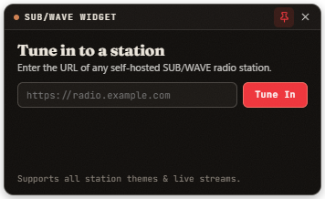

# SubWave Desktop Widget

A small, frameless Windows desktop radio widget for any self-hosted **[SUB/WAVE](https://github.com/perminder-klair/subwave)** station.

Designed for listeners who love SUB/WAVE's broadcast themes, typography, and live metadata — without dedicating a full browser window to the player.



## Features

- **Connect to Any SUB/WAVE Station**
  - Clean first-launch station prompt (`https://radio.example.com` or LAN `http://192.168.x.x:7700`).
  - Supports **public** stations and **password-protected private** stations (`/api/station-auth` listener password — never asks for admin credentials).
  - Remembers multiple stations so you can switch between favorite SUB/WAVE broadcasts right from the System Tray or right-click menu.
- **Two Ultra-Tidy Desktop Modes**
  - **Compact Card (`356 × 192 px`):** Album cover art, auto-scrolling marquee track title, artist/album, year/genre/BPM telemetry, server-synced progress bar, live play/stop button (Opus or MP3), scroll-wheel volume slider, and listener count.
  - **Ultra-Mini Pill Bar (`344 × 58 px`):** Collapses with one click into a sleek ~50px horizontal capsule you can park anywhere on your screen.
- **Full SUB/WAVE Theme Engine**
  - Pulls `/api/themes` live from the connected station — supporting all **8 built-in palettes** (`Classic Light`, `Classic Dark`, `Vinyl`, `Blueprint`, `Cyberpunk`, `Phosphor`, `Recon`, `Riso`) **plus any custom `.json` themes** installed on that station.
  - Defaults to **Use station default** (automatically follows station/show theme changes) or lets you lock in any personal theme override, complete with SUB/WAVE's curated Google Fonts, grain, CRT scanlines/bloom (`Phosphor`), and halftone/two-drum misregister (`Riso`).
- **Native Windows Desktop Ergonomics**
  - Frameless rounded window, **Pin Always-on-Top** toggle, **System Tray** icon with live play indicator, **Windows Media Keys** (`Play/Pause` + Windows 11 media flyout with cover art), and persistent position/volume/theme settings across restarts.

## Installation (Windows)

Download the latest release from **[GitHub Releases](https://github.com/wyliebutler/Subwave_widget/releases)**:

- **`SubWave-Widget-Setup.exe`** *(Recommended)* — Per-user installer (no administrator prompt required), creates Start Menu / Desktop shortcuts, and launches instantaneously.
- **`SubWave-Widget-Portable.exe`** — Single-file portable executable you can run from any folder or USB drive with zero installation.

> **Note on Windows SmartScreen:** Because builds are unsigned open-source binaries, Windows may display *"Windows protected your PC"* on first launch. Click **More info → Run anyway**.

## Controls & Shortcuts

| Action | Shortcut / Gesture |
| --- | --- |
| Play / Stop Live Stream | `Space` or Play button |
| Mute / Unmute | `M` or Speaker icon |
| Adjust Volume (5% steps) | Mouse wheel over the volume slider / speaker icon |
| Collapse / Expand Pill Mode | Pill icon in header (`—`) or System Tray menu |
| Pin Always on Top | Pin icon in header or System Tray menu |
| Switch Theme or Station | Palette icon in header or Right-click anywhere |
| Hide to System Tray | Click `×` while streaming (or click the Tray icon) |

## Building from Source

```powershell
git clone https://github.com/wyliebutler/Subwave_widget.git
cd Subwave_widget
npm install
npm start
```

To package both `SubWave-Widget-Setup.exe` and `SubWave-Widget-Portable.exe` into `dist/`:

```powershell
npm run dist
```

## License

[MIT](./LICENSE)
